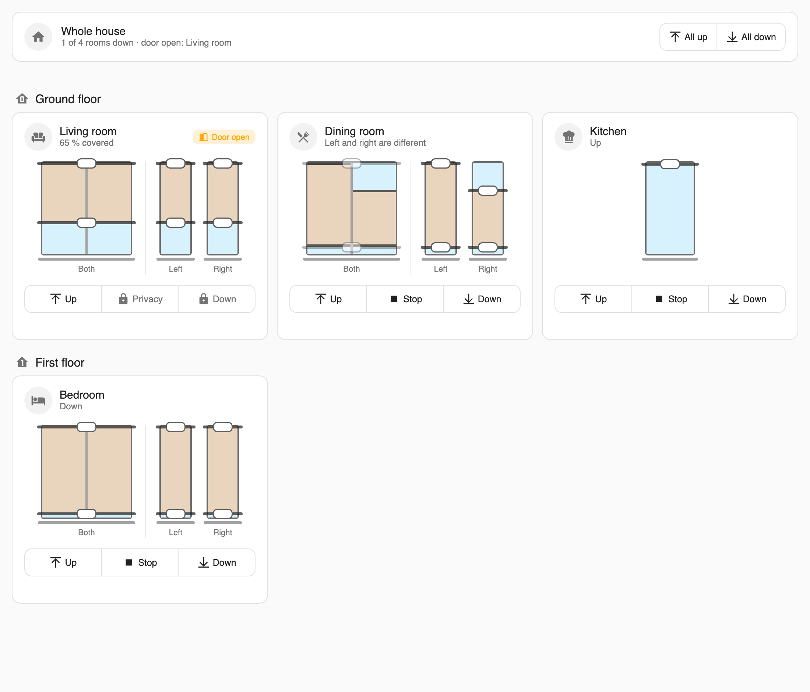
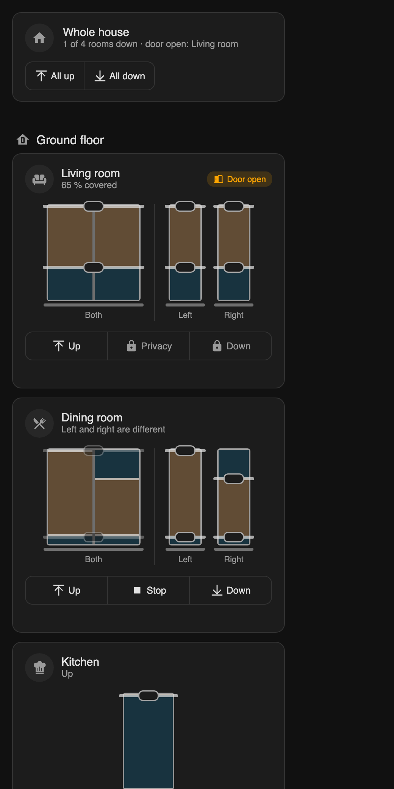
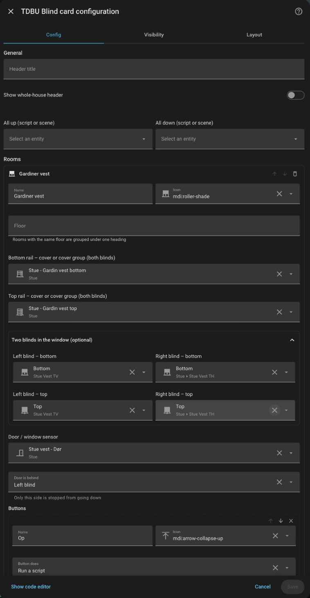

# TDBU Blind Card

A Home Assistant dashboard card for **top-down/bottom-up (TDBU) blinds**, such as Hunter Douglas PowerView (Duette and similar).

Each window gets one picture you can drag. The big **Both** window moves both blinds in the window together, and the small **Left** and **Right** windows move one blind at a time. Buttons always work on the whole room, and an open door only stops the blind from going *down*.

<a href="https://my.home-assistant.io/redirect/hacs_repository/?owner=WackeySSL&repository=tdbu_blind_card&category=plugin" target="_blank" rel="noreferrer noopener"></a>



<p align="center">
  
  &nbsp;&nbsp;
  
</p>

## Contents

- [Features](#features)
- [Installation](#installation)
- [Set it up with the visual editor](#set-it-up-with-the-visual-editor)
- [How the positions work](#how-the-positions-work)
- [YAML reference](#yaml-reference)
- [Examples](#examples)
- [Doors and windows](#doors-and-windows)
- [Upgrading from version 1](#upgrading-from-version-1)
- [Troubleshooting](#troubleshooting)
- [Changelog](#changelog)

## Features

- **Drag the rails.** Drag the top and bottom rails in the window picture. While you drag, the card shows how much of the window is covered.
- **Two blinds in one window.** "Both" moves the left and right blinds together. "Left" and "Right" move one blind. When the two blinds stand differently, the big window shows each side as it really is.
- **Buttons for the whole room.** Use the standard Up · Stop · Down buttons, or make your own: run a script, activate a scene, or move to fixed positions.
- **Door and window safety.** If the door behind a blind is open, the bottom rail can't be moved down, by dragging or with a button. You can still move it up.
- **One room or the whole house.** Use one card per room, or put every room in a single card, grouped by floor. The whole-house header has *All up* and *All down* buttons and shows how many rooms are down.
- **Visual editor.** You can set up everything without YAML. Pick blinds, sensors and scripts from lists, and add, remove and reorder rooms and buttons.
- **Light and dark themes**, phone and desktop layouts, and English and Danish text. The card follows your Home Assistant language.

## Installation

### HACS (recommended)

1. Open **HACS** in Home Assistant.
2. Open the menu (⋮) at the top right and choose **Custom repositories**.
3. Add `https://github.com/WackeySSL/tdbu_blind_card` with the type **Dashboard**.
4. Search for **TDBU Blind Card**, open it and choose **Download**.
5. Reload your browser. On the phone app, pull down to refresh, or clear the app's frontend cache.

HACS adds the resource for you.

### Manual

1. Download `tdbu_blind_card.js` from the [latest release](https://github.com/WackeySSL/tdbu_blind_card/releases/latest).
2. Copy it to `/config/www/tdbu_blind_card.js`.
3. Go to **Settings → Dashboards → ⋮ → Resources → Add resource**. Enter the URL `/local/tdbu_blind_card.js`, choose the type **JavaScript module**, and save.
4. Reload your browser.

## Set it up with the visual editor

1. Open a dashboard, choose **Edit dashboard**, and then **Add card**.
2. Search for **TDBU Blind Card**.
3. For each room:
   - **Bottom rail** and **Top rail**: pick the cover entities for the window. If the window has two blinds, pick a [cover group](https://www.home-assistant.io/integrations/cover.group/) here so "Both" moves them together.
   - **Two blinds in the window**: pick the left and right blind's own entities. This adds the small Left and Right windows.
   - **Door / window sensor** and **Door is behind**: pick the sensor and the blind it sits behind.
   - **Buttons**: leave them as they are for Up · Stop · Down, or add your own.
4. To put several rooms in one card, use **Add room**. Rooms with the same **Floor** are grouped under one heading. Turn on **Show whole-house header** to get All up and All down.

## How the positions work

The card uses the same positions as the PowerView integration:

| Rail | Entity | Position |
| --- | --- | --- |
| Top rail | `top` (the "top" cover) | `0` = rail at the top of the window, `100` = rail at the bottom |
| Bottom rail | `bottom` (the "bottom" cover) | `100` = blind fully up, `0` = blind fully down |

So *fully down* is `top: 0, bottom: 0`, and *fully up* is `top: 0, bottom: 100`. Blinds that only move from the bottom need just `bottom`.

## YAML reference

### Card

| Option | Type | Default | Description |
| --- | --- | --- | --- |
| `type` | string | **required** | `custom:tdbu-blind-card` |
| `rooms` | list | **required** | One or more rooms, see below |
| `title` | string | `Whole house` | Title of the whole-house header |
| `show_header` | boolean | `true` with 2+ rooms | Show the whole-house header |
| `all_up` | entity | – | Script or scene for the **All up** button |
| `all_down` | entity | – | Script or scene for the **All down** button |
| `menu` | list | – | Extra items in the header's ⋯ menu: `name`, `icon`, `entity` (script, scene or automation) and optional `data` |
| `icon` | icon | `mdi:home` | Icon of the whole-house header |
| `language` | string | your HA language | `en` or `da`. Forces the card's language |

### Room

| Option | Type | Description |
| --- | --- | --- |
| `name` | string | Room name. Defaults to the blind's friendly name |
| `icon` | icon | Room icon |
| `floor` | string | Rooms with the same floor are grouped under one heading |
| `floor_icon` | icon | Icon for the floor heading (set it on the floor's first room) |
| `bottom` | entity | Bottom rail of the window (a cover, or a cover group for two blinds). **Required**, unless both `left_bottom` and `right_bottom` are set |
| `top` | entity | Top rail of the window (a cover or cover group). Leave it out for bottom-up blinds |
| `left_bottom`, `left_top` | entity | The left blind's own entities |
| `right_bottom`, `right_top` | entity | The right blind's own entities |
| `left_name`, `right_name` | string | Labels under the small windows. Default: Left / Right |
| `door` | entity | `binary_sensor` that is `on` when the door or window is open |
| `door_side` | string | `both` (default), `left` or `right`: the blind the door sits behind |
| `buttons` | list | Buttons for the room. Leave it out for Up · Stop · Down. `[]` shows no buttons |

### Button

| Option | Type | Description |
| --- | --- | --- |
| `name` | string | Button text |
| `icon` | icon | Button icon |
| `script` | entity | Script to run |
| `entity` | entity | Scene, script, button or automation to run instead of `script` |
| `position` | map | Move the room's blinds: `top` and/or `bottom`, using the numbers above |
| `action` | string | `stop`: stop all blinds in the room |
| `door_check` | boolean | Block the button while the door is open. Buttons with `position` work this out themselves. Set it on scripts and scenes that move the blind down |
| `data` | map | Variables passed to a script, or data for an automation |

## Examples

### One blind, standard buttons

```yaml
type: custom:tdbu-blind-card
rooms:
  - name: Office
    top: cover.office_top
    bottom: cover.office_bottom
```

### Two blinds in one window, with a terrace door

```yaml
type: custom:tdbu-blind-card
rooms:
  - name: Living room
    icon: mdi:sofa
    top: cover.living_top            # cover group: both top rails
    bottom: cover.living_bottom      # cover group: both bottom rails
    left_top: cover.living_left_top
    left_bottom: cover.living_left_bottom
    right_top: cover.living_right_top
    right_bottom: cover.living_right_bottom
    door: binary_sensor.terrace_door
    door_side: right
    buttons:
      - name: Up
        icon: mdi:arrow-collapse-up
        position: { top: 0, bottom: 100 }
      - name: Privacy
        icon: mdi:arrow-collapse-down
        position: { top: 50, bottom: 0 }
      - name: Down
        icon: mdi:arrow-collapse-down
        position: { top: 0, bottom: 0 }
```

### The whole house, grouped by floor, with your own scripts

```yaml
type: custom:tdbu-blind-card
title: Whole house
all_up: script.blinds_all_up
all_down: script.blinds_all_down
menu:
  - name: Update positions
    icon: mdi:update
    entity: automation.blinds_update_positions
    data: { skip_condition: true }
rooms:
  - name: Kitchen
    icon: mdi:chef-hat
    floor: Ground floor
    floor_icon: mdi:home-floor-0
    bottom: cover.kitchen_bottom
    left_bottom: cover.kitchen_left
    right_bottom: cover.kitchen_right
  - name: Dining room
    icon: mdi:silverware-variant
    floor: Ground floor
    top: cover.dining_top
    bottom: cover.dining_bottom
    door: binary_sensor.dining_door
    buttons:
      - { name: Up, icon: mdi:arrow-collapse-up, script: script.dining_up }
      - { name: Down, icon: mdi:arrow-collapse-down, script: script.dining_down, door_check: true }
  - name: Bedroom
    icon: mdi:bed
    floor: First floor
    floor_icon: mdi:home-floor-1
    top: cover.bedroom_top
    bottom: cover.bedroom_bottom
```

## Doors and windows

When `door` is `on`:

- the room shows a **Door open** label;
- the bottom rail can't be dragged lower, in "Both" or on the door's side (`door_side`). Up still works;
- buttons that would move the blind down show a lock, and the card says why when you press them. Buttons with `position` work this out themselves. For scripts and scenes, set `door_check: true`;
- **All down** says which rooms are skipped. Your script decides whether they are actually skipped, so add the door check to the script as well.

The card only blocks what it sends itself. Automations and scripts still need their own door checks.

## Upgrading from version 1

Version 2 is a new card with a much simpler setup. **Your version 1 cards keep working**, so nothing breaks when you update.

### What changes

| Version 1 | Version 2 |
| --- | --- |
| `type: custom:tdbu-mushroom-style-card` | `type: custom:tdbu-blind-card`. The old type still works and is converted automatically |
| One card per blind | One card per room, or the whole house in one card |
| An open door locked the whole card | An open door only stops the blind from going **down**. Up still works |
| `show_buttons` (up, stop, down on the left) | Buttons under the window. Standard: Up · Stop · Down |
| `slider_width` | Not used. The window picture sizes itself |
| No visual editor | Visual editor |

### Step by step

1. **Update the card.** In HACS, open TDBU Blind Card and download version 2.0.0. If you installed it manually, replace `tdbu_blind_card.js` and add `?v=2` to the resource URL so browsers fetch the new file.
2. **Reload the browser.** On phones, refresh or clear the frontend cache in the app. Your existing cards now run on version 2.
3. **Optional: switch to the new format.** Open an old card in the editor and press **Save**, and it's stored in the new format. Or change the YAML yourself:

| Version 1 | Version 2 |
| --- | --- |
| `name: Kitchen` | `rooms: [{ name: Kitchen, … }]` |
| `entity_bottom: cover.x_bottom` | `bottom: cover.x_bottom` |
| `entity_top: cover.x_top` | `top: cover.x_top` |
| `disable_if_sensor_open: binary_sensor.door` | `door: binary_sensor.door` |
| `show_buttons: false` | `buttons: []` |
| `slider_width: 100px` | Remove it |

Before:

```yaml
type: custom:tdbu-mushroom-style-card
name: Kitchen blind
entity_top: cover.kitchen_top
entity_bottom: cover.kitchen_bottom
disable_if_sensor_open: binary_sensor.kitchen_door
show_buttons: true
slider_width: 100px
```

After:

```yaml
type: custom:tdbu-blind-card
rooms:
  - name: Kitchen blind
    top: cover.kitchen_top
    bottom: cover.kitchen_bottom
    door: binary_sensor.kitchen_door
```

4. **Optional: combine blinds.** If two old cards were the left and right blind of one window, put them in one room. Use `left_*` and `right_*` for the two blinds, and a [cover group](https://www.home-assistant.io/integrations/cover.group/) for `top` and `bottom` (see the [example](#two-blinds-in-one-window-with-a-terrace-door)).

## Troubleshooting

- **"Custom element doesn't exist: tdbu-blind-card"**: the resource isn't loaded. Check **Settings → Dashboards → Resources**, then reload the browser and clear the cache. Version 1.0.x registered a different name than its README said; 2.0.0 fixes that ([#1](https://github.com/WackeySSL/tdbu_blind_card/issues/1)).
- **The rails are upside down**: check that `top` and `bottom` aren't swapped. The top rail uses the top entity.
- **The door doesn't block anything**: the sensor must be `on` when the door is open (device class door, window or opening).
- **Something else**: add `debug: true` to the card, and every command it sends is written to the browser console. Then [open an issue](https://github.com/WackeySSL/tdbu_blind_card/issues).

## Changelog

### 2.0.1

- Release made after the HACS validation passed, as required for the HACS default list. The card is the same as 2.0.0.

### 2.0.0

- New card `custom:tdbu-blind-card`: one window per room with draggable rails, "Both" plus Left and Right.
- Visual editor.
- Several rooms in one card, grouped by floor, with a whole-house header (All up, All down and an ⋯ menu).
- Buttons can run scripts and scenes, move to positions or stop. Standard buttons: Up · Stop · Down.
- An open door only stops the blind from going down, and only on the door's side.
- English and Danish.
- Version 1 cards keep working. The old type is converted automatically.
- Fixes "Custom element not found: tdbu-blind-card" ([#1](https://github.com/WackeySSL/tdbu_blind_card/issues/1)).
- HACS: the repository is now set up as a dashboard plugin.

### 1.0.1, 1.0.0

- First versions: one blind per card, with up, stop and down buttons.

## License

[Apache License 2.0](LICENSE)
